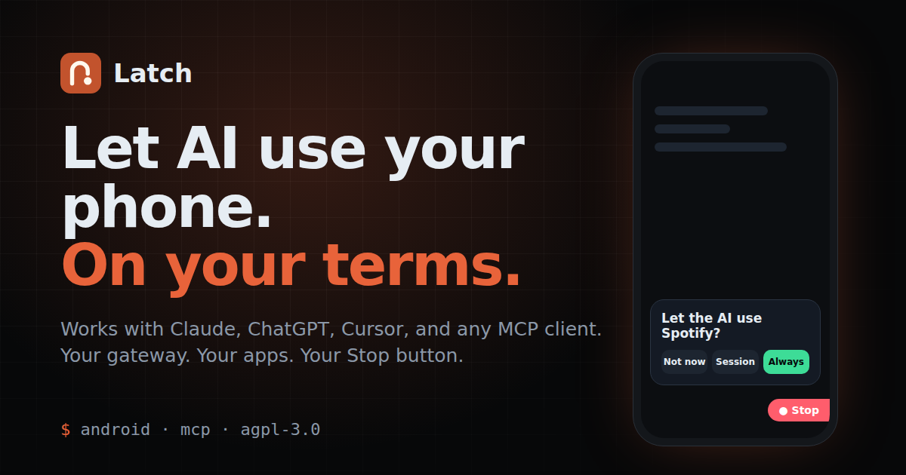
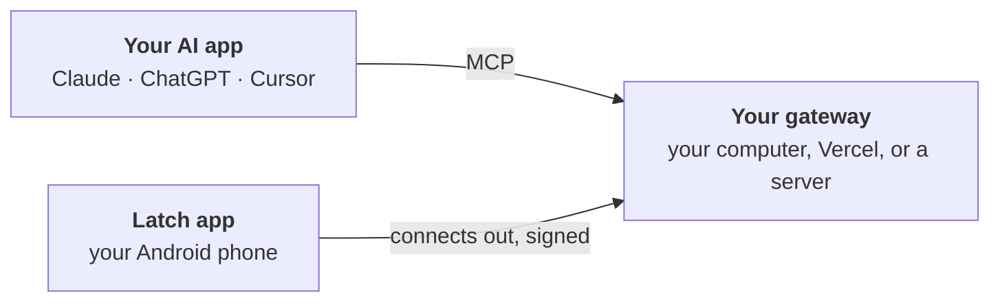

<div align="center">



<h3>Let any AI app use your Android phone. On your terms.</h3>

[](https://github.com/aspershupadhyay/latch/actions/workflows/ci.yml)
[](https://github.com/aspershupadhyay/latch/releases/download/beta/latch-android.apk)
[](docs/tools.md)
[](LICENSE)

[**Download the beta**](https://github.com/aspershupadhyay/latch/releases/download/beta/latch-android.apk) &nbsp;·&nbsp;
[**Set up in 5 minutes**](docs/setup.md) &nbsp;·&nbsp;
[Website](https://aspershupadhyay.github.io/latch/) &nbsp;·&nbsp;
[Safety](docs/safety.md) &nbsp;·&nbsp;
[Benchmarks](https://aspershupadhyay.github.io/latch/benchmark.html)

</div>

---

Latch is an Android app and a small gateway that you own. Claude, ChatGPT, Cursor, or any other [MCP](https://modelcontextprotocol.io) app connects to your gateway and can read your screen, tap, type, and move files, but only in the apps you switch on, and never past a payment, a password, or the Stop button. Developers can also switch on full ADB shell access over Wi-Fi.

Your phone connects out to a gateway you run: on your computer, your free Vercel account, or your own server. No cable, and no Latch server in the middle.

> [!NOTE]
> Latch is in **beta**. Every change passes CI, including the real app on an Android emulator, but it has not yet been tested on many phones. [Report what breaks.](https://github.com/aspershupadhyay/latch/issues)

## How it works



- **The app** reads the screen through Android's accessibility service and performs the taps. Every rule is checked again on the phone, against what is on screen at that moment.
- **The gateway** speaks MCP to your AI app and passes typed commands to the phone. It cannot do anything the phone refuses.
- **You** choose which apps the AI may use, approve anything risky on the phone, and stop everything with one tap.

## Quick start

**1. Install the app** on an Android 11+ phone: [latch-android.apk](https://github.com/aspershupadhyay/latch/releases/download/beta/latch-android.apk).

**2. Run a gateway.** Pick one:

- **On your computer**, for a phone on the same Wi-Fi:

  | | |
  |---|---|
  | macOS, Linux | `curl -fsSL https://github.com/aspershupadhyay/latch/releases/download/beta/install-gateway.sh \| sh` |
  | Windows (PowerShell) | `irm https://github.com/aspershupadhyay/latch/releases/download/beta/install-gateway.ps1 \| iex` |
  | From v0.1.0 | `brew install latch` · `winget install AspershUpadhyay.Latch` · `scoop install latch` ([how](docs/install.md#as-a-package-from-v010)) |

  Then run `latch start` and, in the app, tap **Scan the QR code**.

- **Anywhere, on your free Vercel account**: in the app, tap **Create my own gateway**, copy the owner key, and

  [](https://vercel.com/new/clone?repository-url=https%3A%2F%2Fgithub.com%2Faspershupadhyay%2Flatch&root-directory=servers%2Fvercel&project-name=latch-gateway&repository-name=latch-gateway&env=LATCH_ADMIN_TOKEN&envDescription=Paste+the+owner+key+shown+in+the+Latch+app.+It+stays+in+your+Vercel+project+and+on+your+phone.&envLink=https%3A%2F%2Fgithub.com%2Faspershupadhyay%2Flatch%2Fblob%2Fmain%2Fdocs%2Foperations%2Fvercel.md&stores=%5B%7B%22type%22%3A%22integration%22%2C%22integrationSlug%22%3A%22upstash%22%2C%22productSlug%22%3A%22upstash-kv%22%2C%22protocol%22%3A%22storage%22%7D%5D)

**3. Connect your AI app.** Add the gateway's `/mcp` address as a remote MCP server (`latch start` prints the exact command for Claude Code), then approve the 4-letter code on the phone.

Start a session on the phone and ask: *"What's on my screen right now?"* Every tap, screen by screen: **[setup guide](docs/setup.md)**.

## Why Latch

| | |
|---|---|
| **Any AI app** | One MCP address for Claude, ChatGPT, Cursor, Codex, VS Code, and the rest. Each signs in with OAuth that you approve on the phone, or gets its own key. |
| **You stay in charge** | Every app is off until you switch it on. Send, Pay, Install, and permission prompts ask you first. Password, PIN, and one-time-code fields are refused. Screen text is data, never an instruction. A Stop button is always on screen. |
| **Every gesture, fast** | Tap, swipe, drag, pinch, and any multi-finger gesture. Actions return only what changed; `run_steps` and saved skills do several steps in one call. |
| **Full ADB, no cable** | Optional and off by default: pair wireless debugging once, and your AI app runs any `adb shell` command over Wi-Fi, with complete output. You turn it on; Stop ends it. [Compared with ADB agents →](https://aspershupadhyay.github.io/latch/security.html) |
| **Files and a live mirror** | Files up to 2 GB over encrypted 15-minute links, and the phone's screen live in your browser, with mouse and keyboard. |
| **Yours to run** | Your computer, a free Vercel deploy, or a small container. No Latch server in the middle, and Latch collects nothing. AGPL-3.0. |

## Documentation

| Guide | What it covers |
|---|---|
| [Setup](docs/setup.md) · [Install the gateway](docs/install.md) · [Connect your phone](docs/connect-your-phone.md) | Getting started, screen by screen |
| [Troubleshooting](docs/troubleshooting.md) | Play Protect, Restricted setting, sessions that drop, slow actions, updating your gateway |
| [Safety and privacy](docs/safety.md) | What the AI can and cannot do, and what is stored where |
| [MCP tools](docs/tools.md) | Every tool an AI app can call, including any gesture and full-access ADB |
| [Run on Vercel](docs/operations/vercel.md) · [Self-host](docs/operations/gateway.md) · [Releases](docs/operations/release.md) | Operating a gateway, keys, big files, and how releases are made |
| [Device protocol](docs/protocol/v1.md) · [Decisions](docs/adr/README.md) · [Handbook](handbook/README.md) | The phone ↔ gateway contract, why it looks this way, and the [roadmap](handbook/17-plan-review-and-revised-delivery.md) |

<a name="help-im-stuck"></a><a name="phone-and-vercel-settings"></a><a name="set-it-up-about-5-minutes"></a><a name="fix-update-your-gateway"></a><a name="fix-app-blocked-by-play-protect"></a><a name="fix-restricted-setting"></a><a name="fix-session-stops-when-the-screen-is-off"></a><a name="fix-ai-actions-are-slow"></a>
**Stuck?** "App blocked", a greyed-out accessibility switch, a session that stops with the screen off, or slow actions: [troubleshooting](docs/troubleshooting.md) has each fix. Anything else: [open an issue](https://github.com/aspershupadhyay/latch/issues).

**iPhone:** iOS has no public way for one app to operate another, so a full iPhone version is not possible ([why](handbook/06-ios-application-plan.md)).

## Develop

```sh
scripts/cloud-session-setup.sh   # once: Rust, the Android SDK, and the test clients
scripts/dev.sh                   # a local gateway and a simulated phone, no device needed
scripts/check.sh                 # everything CI runs
```

| Path | What lives there |
|---|---|
| [`apps/android`](apps/android) | The app (Kotlin, Jetpack Compose) |
| [`servers/mcp`](servers/mcp) · [`servers/vercel`](servers/vercel) | The gateway for computers and containers (Rust) and for Vercel (TypeScript) |
| [`crates/protocol`](crates/protocol) · [`crates/policy`](crates/policy) | The device protocol and the rules that decide what is allowed |
| [`crates/fake-device`](crates/fake-device) · [`packages/schemas`](packages/schemas) | A simulated phone, and the schemas and fixtures every implementation shares |
| [`packaging`](packaging) · [`scripts`](scripts) | The `latch` command, the package manifests, and the installers |

CI runs on every pull request: Rust, both gateways end to end, the official MCP SDK client, the Android build, the real app on an emulator, both installers on Linux and Windows, the container image, and a dependency audit. Read [CONTRIBUTING.md](CONTRIBUTING.md) first, and report vulnerabilities privately via [SECURITY.md](SECURITY.md). Also: [GOVERNANCE.md](GOVERNANCE.md) · [CHANGELOG.md](CHANGELOG.md) · [SUPPORT.md](SUPPORT.md).

## License

[GNU AGPL-3.0](LICENSE), with the attribution terms in [NOTICE](NOTICE). You may use, study, and change Latch. If you share a changed version, or run it as a service other people connect to, publish your source under the same license and keep the credit *Based on Latch by Aspersh Upadhyay*. The name and logo are not licensed for forks: see [TRADEMARKS.md](TRADEMARKS.md).
