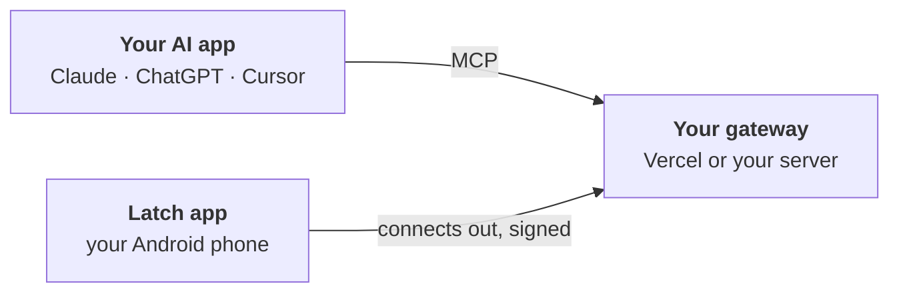

<div align="center">


<h3>Let any AI app use your Android phone. On your terms.</h3>

[](https://github.com/aspershupadhyay/latch/actions/workflows/ci.yml)
[](https://github.com/aspershupadhyay/latch/releases/download/beta/latch-android.apk)
[](docs/tools.md)
[](LICENSE)

[**Download the beta**](https://github.com/aspershupadhyay/latch/releases/download/beta/latch-android.apk) &nbsp;·&nbsp;
[**Set up in 5 minutes**](docs/setup.md) &nbsp;·&nbsp;
[Website](https://aspershupadhyay.github.io/latch/) &nbsp;·&nbsp;
[Safety](docs/safety.md) &nbsp;·&nbsp;
[Benchmarks](https://aspershupadhyay.github.io/latch/benchmark.html)

</div>

---

Latch is an Android app and a small gateway that you own. Claude, ChatGPT, Cursor, or any other [MCP](https://modelcontextprotocol.io) app connects to your gateway and can read your screen, tap, type, and move files, but only in the apps you switch on, and never past a payment, a password, or the Stop button.

No cable, no laptop left running, and no Latch server in the middle. Your phone connects out to a gateway on your own free Vercel account or your own server.

> [!NOTE]
> Latch is in **beta**. Every change passes CI, including the real app on an Android emulator, but it has not yet been tested on many phones. [Report what breaks.](https://github.com/aspershupadhyay/latch/issues)

## How it works



1. **The app** reads the screen through Android's accessibility service and performs the taps. Every rule is checked again on the phone, against what is on screen at that moment.
2. **The gateway** speaks MCP to your AI app and passes typed commands to the phone. It cannot do anything the phone refuses.
3. **You** decide which apps the AI may use, approve anything risky on the phone, and can stop everything with one tap.

## Why Latch

| | |
|---|---|
| **Works with any AI app** | One MCP address for Claude, ChatGPT, Cursor, Codex, VS Code, and the rest. Each AI app signs in with OAuth, which you approve on the phone, or gets its own key. |
| **You stay in charge** | Every app is off until you switch it on. Send, Pay, Install, and permission prompts ask you first. Password, PIN, and one-time-code fields are refused. Text on screen is treated as data, never as an instruction. |
| **Fast loops** | Actions return only what changed on screen. `run_steps` and saved skills do several steps in one call. `wait_for` and `scroll_to` replace polling. |
| **Sees what others miss** | Icon-only buttons are read on the phone, so an unlabeled "Send" still asks you before the AI taps it. |
| **Files without the cloud** | Whole files, up to 2 GB, move between your computer and the phone over encrypted 15-minute links. The storage in between only ever holds encrypted bytes. |
| **Yours to run** | A free Vercel deploy or a small container. Messages from the phone are signed by a key kept in its keystore. Latch itself collects nothing. AGPL-3.0. |

## Quick start

1. **Install the app.** Download [latch-android.apk](https://github.com/aspershupadhyay/latch/releases/download/beta/latch-android.apk) on an Android 11+ phone and open it.
2. **Create your gateway.** In the app, tap **Create my own gateway**, copy the owner key, and deploy with one click:

   [](https://vercel.com/new/clone?repository-url=https%3A%2F%2Fgithub.com%2Faspershupadhyay%2Flatch&root-directory=servers%2Fvercel&project-name=latch-gateway&repository-name=latch-gateway&env=LATCH_ADMIN_TOKEN&envDescription=Paste+the+owner+key+shown+in+the+Latch+app.+It+stays+in+your+Vercel+project+and+on+your+phone.&envLink=https%3A%2F%2Fgithub.com%2Faspershupadhyay%2Flatch%2Fblob%2Fmain%2Fdocs%2Foperations%2Fvercel.md&stores=%5B%7B%22type%22%3A%22integration%22%2C%22integrationSlug%22%3A%22upstash%22%2C%22productSlug%22%3A%22upstash-kv%22%2C%22protocol%22%3A%22storage%22%7D%5D)

3. **Connect your AI.** Add `https://<your-gateway>/mcp` as a remote MCP server in your AI app, then approve the matching 4-letter code in the Latch app.

Then start a session on the phone and ask: *"What's on my screen right now?"*

**[Full setup guide →](docs/setup.md)** (every tap, screen by screen)

## Latch compared with ADB agents

Tools such as Google's ARTEMIS drive a phone over a USB cable from a computer, mainly for app testing. Latch is built for your own phone, used every day:

| | Latch | ADB test agent |
|---|---|---|
| Connection | The app on your phone connects out to your gateway | USB debugging, plus a computer nearby |
| Which AI | Any MCP app | Its own agent loop |
| Owner approval for Send, Pay, Install | On the phone, by default | Not documented |
| Password and one-time-code fields | Refused | Not documented |
| Stop | Always on screen, plus session expiry and revocation | Not documented |

Sources and the full comparison: [security page](https://aspershupadhyay.github.io/latch/security.html).

## Documentation

| Guide | What it covers |
|---|---|
| [Setup](docs/setup.md) | Install, deploy, connect an AI, choose what it may do, files, skills |
| [Troubleshooting](docs/troubleshooting.md) | Play Protect, Restricted setting, sessions that drop, slow actions, updating your gateway |
| [Safety and privacy](docs/safety.md) | What the AI can and cannot do, and what is stored where |
| [MCP tools](docs/tools.md) | All 34 tools an AI app can call |
| [Run on Vercel](docs/operations/vercel.md) · [Self-host](docs/operations/gateway.md) | Operating either gateway, owner key rotation, big files |
| [QA and emulators](docs/operations/qa.md) | Fake phones, emulators, several phones, the Python client |
| [Device protocol](docs/protocol/v1.md) · [Decisions](docs/adr/README.md) | The phone ↔ gateway contract and why it looks the way it does |
| [Handbook](handbook/README.md) | The product and engineering plan, including the [roadmap](handbook/17-plan-review-and-revised-delivery.md) |

## Help

<a name="help-im-stuck"></a><a name="phone-and-vercel-settings"></a><a name="set-it-up-about-5-minutes"></a><a name="fix-update-your-gateway"></a><a name="fix-app-blocked-by-play-protect"></a><a name="fix-restricted-setting"></a><a name="fix-session-stops-when-the-screen-is-off"></a><a name="fix-ai-actions-are-slow"></a>

| If you see… | Go to |
|---|---|
| "App blocked to protect your device" | [Play Protect](docs/troubleshooting.md#fix-app-blocked-by-play-protect) |
| "Restricted setting", or the accessibility switch is greyed out | [Restricted setting](docs/troubleshooting.md#fix-restricted-setting) |
| The session stops when the screen is off | [Battery settings by phone brand](docs/troubleshooting.md#fix-session-stops-when-the-screen-is-off) |
| "Update your gateway", or tools are missing | [Update your gateway](docs/troubleshooting.md#fix-update-your-gateway) |
| Every action takes seconds | [Match your regions](docs/troubleshooting.md#fix-ai-actions-are-slow) |

Anything else: [troubleshooting](docs/troubleshooting.md), then [open an issue](https://github.com/aspershupadhyay/latch/issues).

## Develop

```sh
scripts/cloud-session-setup.sh   # once: Rust, the Android SDK, and the test clients
scripts/dev.sh                   # a local gateway and a simulated phone, no device needed
scripts/check.sh                 # everything CI runs
```

| Path | What lives there |
|---|---|
| [`apps/android`](apps/android) | The app (Kotlin, Jetpack Compose) |
| [`servers/vercel`](servers/vercel) · [`servers/mcp`](servers/mcp) | The gateway for Vercel (TypeScript) and for containers (Rust) |
| [`crates/protocol`](crates/protocol) · [`crates/policy`](crates/policy) | The device protocol and the rules that decide what is allowed |
| [`crates/fake-device`](crates/fake-device) | A simulated phone for tests and demos |
| [`packages/schemas`](packages/schemas) | JSON Schemas and fixtures shared by every implementation |
| [`adapters/python`](adapters/python) · [`tests/interop`](tests/interop) | A Python client, and checks against the official MCP SDK |

CI runs on every pull request: Rust, both gateways end to end, the official MCP SDK client, the Android build, the real app on an emulator, the container image, and a dependency audit. Read [CONTRIBUTING.md](CONTRIBUTING.md) before your first pull request, and [SECURITY.md](SECURITY.md) to report a vulnerability privately.

**iPhone:** iOS has no public way for one app to operate another, so a full iPhone version is not possible. See [handbook chapter 06](handbook/06-ios-application-plan.md).

## License

[GNU AGPL-3.0](LICENSE), with the attribution terms in [NOTICE](NOTICE). You may use, study, and change Latch. If you share a changed version, or run it as a service other people connect to, publish your source under the same license and keep the credit *Based on Latch by Aspersh Upadhyay*. The name and logo are not licensed for forks: see [TRADEMARKS.md](TRADEMARKS.md).
